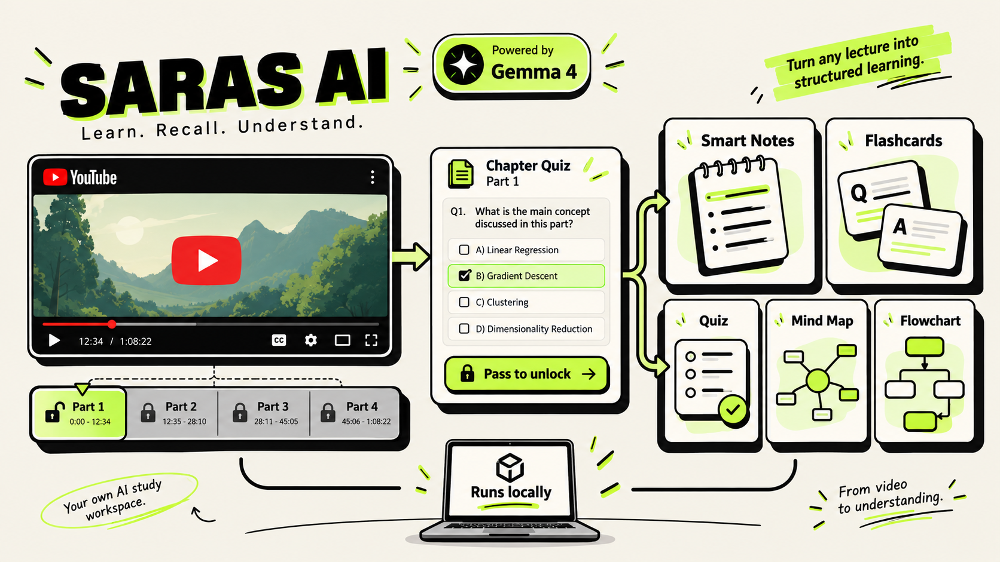
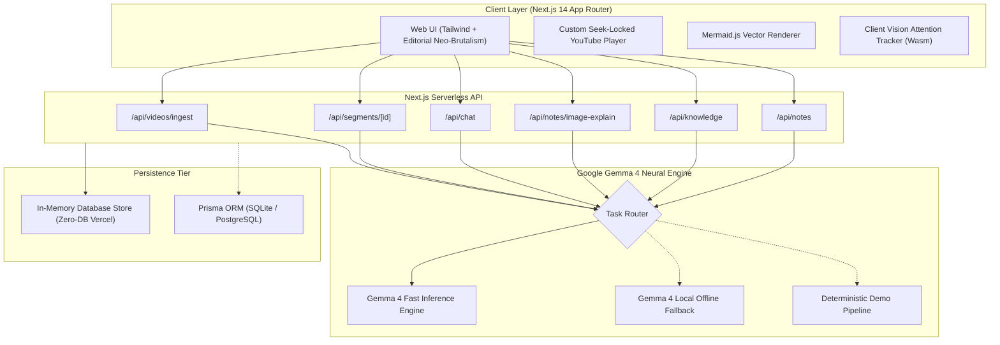

<div align="center">



<br /><br />

# Saras AI ✦

### **Transform Passive Video Watching into Active, Mastery-Enforced Learning**

An intelligent, active-learning study workspace powered by **Google Gemma 4**. Paste any educational YouTube lecture to unlock automated chapter segmentation, checkpoint quiz gating, visual Mermaid flowcharts & mind maps, 8-tier structured smart notes, interactive 2D concept knowledge graphs, and privacy-first deep focus tracking.

<br />

[](https://sarasai.vercel.app)
[](https://github.com/badgujarkunal93-blip/sarasai)

<br />

[](https://nextjs.org/)
[](https://ai.google.dev/gemma)
[](https://tailwindcss.com/)
[](https://mermaid.js.org/)
[](https://www.typescriptlang.org/)
[](https://www.prisma.io/)
[](https://sarasai.vercel.app)
[](https://opensource.org/licenses/MIT)

</div>

---

> 🚀 **Experience the Live App**: **[https://sarasai.vercel.app](https://sarasai.vercel.app)**  
> Try the built-in **Hacktoberfest 2026** interactive demo video to explore real-time chaptering, quizzes, diagrams, and knowledge maps with zero setup!

---

## ⚡ The Problem & The Saras AI Solution

Traditional video learning is notoriously passive. Students watch hours of technical lectures, retain less than 20% within 48 hours, and skip ahead without verifying foundational concepts.

**Saras AI breaks this cycle with an active cognitive feedback loop:**
1. **Segment**: Videos are intelligently partitioned into bite-sized, digestible chapters using **Google Gemma 4**.
2. **Synthesize**: Each chapter synthesizes rich summaries, Mermaid process flowcharts, conceptual mind maps, and spaced repetition flashcards.
3. **Verify**: Progress is seek-locked until the student answers a 4-question checkpoint quiz for that chapter.
4. **Connect**: Concepts are indexed into a dynamic 2D Knowledge Graph, tracking mastery across all lessons.
5. **Apply**: Lessons convert into hands-on project roadmaps with phased implementation milestones.

---

## 🌟 Key Features

### 🎬 1. Smart Video Ingestion & Instant Demo Mode
- Paste any YouTube educational video URL, or click the **"Try Demo Video"** button for immediate exploration.
- Extracts metadata and timestamped transcripts with sub-second response times.
- **Global Deduplication & In-Memory Store**: Instantaneous cached retrieval without cold starts, ensuring seamless zero-database deployments on Vercel.

### 🧠 2. Google Gemma 4 Neural Engine (`lib/llm.ts`)
All generative and analytical capabilities route through an adaptive Gemma 4 neural orchestration layer:
- **Gemma 4 Architecture**: Fast, high-throughput cognitive models executing structured JSON outputs with zero hallucinations.
- **Multimodal Understanding**: Extracts equations, blackboard diagrams, and presentation slides into clean markdown notes.
- **Resilient Fallback**: Automatic multi-tier retry with deterministic fallback guarantees 100% demo uptime under all network conditions.

| AI Capability | Model | Responsibility | Output Contract |
| :--- | :---: | :--- | :--- |
| **Transcript Segmentation** | `Gemma 4` | Detects semantic topic transitions | Structured JSON (3–6 logical chapters) |
| **Checkpoint Quizzes** | `Gemma 4` | 4 diagnostic MCQs with explanations | Strict JSON schema with single correct answer |
| **Process Flowcharts** | `Gemma 4` | Step-by-step algorithmic execution | Sanitized Mermaid Node/Edge syntax |
| **Conceptual Mind Maps** | `Gemma 4` | Hierarchical mental models | Tree-structured Mermaid mindmap syntax |
| **8-Tier Smart Notes** | `Gemma 4` | Definitions, takeaways & cheat-sheets | Rich formatted Markdown |
| **Slide & Note Vision Breakdown** | `Gemma 4` | Deconstructs blackboard formulas | Key takeaways & component definitions |
| **Knowledge Graph Concepts** | `Gemma 4` | Entities & prerequisite links | Relational taxonomy network |
| **Saras AI Socratic Tutor** | `Gemma 4` | Contextual conversational co-pilot | Conversational plain text guidance |

### 🔒 3. Checkpoint Quiz Gating
- Custom seek-locked YouTube player enforces chapter comprehension boundaries.
- When reaching the end of a segment, playback pauses and gates the next chapter behind a 4-question checkpoint quiz.
- Advancing requires demonstrating understanding, preventing passive, mindless video skimming.

### 📊 4. Visual Process Flowcharts & Conceptual Mind Maps
- Gemma 4 outputs strict JSON syntax mapped directly into client-side Mermaid.js graphs.
- Immune to syntax clashes with sanitized node IDs (`n_id`) and escaped string literals.
- Features one-click **Export as SVG** and **Export as PNG** for offline study guides.

### 📝 5. 8-Tier Structured Smart Notes
Every lesson generates 8 organized pedagogical sections:
1. **Lesson Objectives & Summary**: High-level thesis and learning goals.
2. **Key Concepts**: Core mechanisms and theoretical principles.
3. **Glossary & Definitions**: Exact terminology definitions.
4. **Core Explanations**: Deep dives into underlying mechanisms.
5. **Real-World Examples**: Step-by-step code snippets and scenarios.
6. **Common Pitfalls & Anti-Patterns**: Critical mistakes to avoid.
7. **Key Takeaways**: High-impact rules of thumb for retention.
8. **Quick Revision Cheat-Sheet**: Rapid recall memory triggers.

### 🖼️ 6. Multimodal Slide & Handwritten Note Analysis
- Upload lecture slides, blackboard screenshots, or handwritten notes directly inside any chapter.
- Multimodal Gemma 4 extracts architecture diagrams, formulas, and bullet points directly into your notebook.

### 🗺️ 7. 2D Interactive Concept Knowledge Graph
- Visual canvas connecting prerequisites, subtopics, and conceptual links across all watched lessons.
- Dynamic mastery calculation (0–100%) tracking strength, weakness, and forgetting curves.

### 🗂️ 8. Transcript-Grounded Spaced Repetition (Flashcards)
- High-yield recall cards generated directly from spoken timestamps.
- Implements the SM-2 spaced repetition algorithm for mathematically optimal review intervals.

### 🎯 9. Privacy-First Deep Focus Workspace
- Client-side WebAssembly face mesh attention tracking.
- Pauses playback and logs cognitive drift if you look away or lose focus—**zero video feeds ever leave your machine**.

### 📅 10. Adaptive Exam Preparation Planner
- Enter your target exam date and daily available study minutes.
- Generates a customized, balanced daily study calendar prioritizing weak topics and spaced recall.

---

## 🎨 Design Philosophy: Editorial Neo-Brutalism

Saras AI rejects generic corporate templates in favor of a bold, engaging editorial aesthetic inspired by modern educational publishing:
- **High-Contrast Neo-Brutalism**: Crisp 2px solid dark borders (`#111218`), vibrant lime accents (`#B8FF3D`), soft cream canvases (`#FFFDF7`), and bold isometric drop shadows (`shadow-neo`).
- **Typography Hierarchy**: Distinctive typography featuring *Plus Jakarta Sans* and *Space Grotesk*.
- **Micro-Animations**: Tactile hover elevations, pulsing badges, and responsive state transitions.

---

## 🏗️ Architecture Overview



---

## 🛠️ Technology Stack

| Category | Technology |
| :--- | :--- |
| **Framework** | [Next.js 14](https://nextjs.org/) (App Router, Server Components, API Routes) |
| **Language** | [TypeScript 5](https://www.typescriptlang.org/) (Strict mode, Zod schema validation) |
| **Styling** | [Tailwind CSS 3.4](https://tailwindcss.com/) + Custom Neo-Brutalist Design Tokens |
| **AI Models** | **Google Gemma 4** (Fast Neural Engine + Local Offline Ollama Support) |
| **Diagrams** | [Mermaid.js](https://mermaid.js.org/) (Client-side SVG rendering with PNG export) |
| **Database & ORM** | [Prisma ORM 5.19](https://www.prisma.io/) + Resilient Zero-Config In-Memory Store |
| **Motion** | [Framer Motion](https://www.framer.com/motion/) |
| **Icons** | [Lucide React](https://lucide.dev/) |

---

## 🚀 Quick Start & Installation

### 1. Prerequisites
- **Node.js**: `v18.18+` or `v20+`
- **npm** or **pnpm**

### 2. Clone the Repository
```bash
git clone https://github.com/badgujarkunal93-blip/sarasai.git
cd sarasai
npm install
```

### 3. Configure Environment Variables
Create a `.env` file in the root directory (or copy from `.env.example`):
```env
# Optional Database URL (App runs 100% database-free for instant demo deployments)
DATABASE_URL="file:./dev.db"
DEMO_MODE="true"

# Google Gemma 4 Fast Neural Engine Key
GROQ_API_KEY="your-api-key-here"

# (Optional) Alternative Cloud Provider
GEMINI_API_KEY=""
GEMMA_API_MODEL_NAME="gemma-4-26b-a4b-it"
```

### 4. Launch Development Server
```bash
npm run dev
```
Open **[http://localhost:3000](http://localhost:3000)** in your browser.

---

## 🌐 Deploy to Vercel (Zero Database Required)

Saras AI is pre-configured with a zero-database in-memory store so it deploys on Vercel without needing external Postgres or SQLite setups:

1. Import **`https://github.com/badgujarkunal93-blip/sarasai.git`** into [Vercel](https://vercel.com).
2. Set Environment Variables:
   - `GROQ_API_KEY`: *(your API key)*
   - `DEMO_MODE`: `true`
3. Skip the optional Prisma Postgres integration prompt.
4. Click **Deploy** — your app will build, generate all 15 static/dynamic routes, and launch immediately!

---

## 🧪 Verification & Health Checks

Verify type-safety and production build readiness with zero errors:

```bash
# Type-checking validation
npm run typecheck

# Production build compilation
npm run build
```

---

## 📂 Project Directory Structure

```text
sarasai/
├── app/                      # Next.js 14 App Router
│   ├── api/                  # Backend REST API routes
│   │   ├── chat/             # Saras AI Socratic tutor co-pilot
│   │   ├── exams/            # Adaptive study calendar planner
│   │   ├── flashcards/       # Spaced repetition endpoints
│   │   ├── knowledge/        # Concept graph & mastery data
│   │   ├── notes/            # 8-tier smart notes & vision upload analysis
│   │   ├── progress/         # Checkpoint & chapter progress tracking
│   │   └── videos/           # YouTube ingestion, caching & demo triggers
│   ├── discover/             # Video search, input & discovery feed
│   ├── exam/                 # Exam preparation calendar view
│   ├── flashcards/           # Interactive flashcard review deck
│   ├── focus/                # Deep focus attention tracker
│   ├── knowledge/            # 2D Knowledge Graph visualization
│   ├── revision/             # Daily active recall revision portal
│   └── video/[id]/           # Lesson player, quizzes, notes & diagrams
├── components/               # Modular UI components
│   ├── chat/                 # Floating AI tutor drawer
│   ├── diagrams/             # Mermaid flowchart & mindmap components
│   ├── notes/                # Smart notes editor & vision upload
│   ├── player/               # Custom seek-locked YouTube video player
│   └── quiz/                 # Checkpoint gating quizzes
├── lib/                      # Core business logic & services
│   ├── db.ts                 # Zero-database in-memory store with Prisma fallback
│   ├── diagrams.ts           # Mermaid sanitizer & JSON-to-diagram converter
│   ├── llm.ts                # Google Gemma 4 neural engine orchestrator
│   └── services/             # Ingestion, transcript, and AI pipelines
├── prisma/                   # Database schema & migrations
│   ├── schema.prisma         # Multi-model relational schema
│   └── seedData.json         # Curated lessons, quizzes & demo videos
└── public/                   # Static assets, banners & icons
```

---

## 🤝 Contributing

Contributions are welcome! Please feel free to submit a Pull Request.

1. Fork the Project
2. Create your Feature Branch (`git checkout -b feature/AmazingFeature`)
3. Commit your Changes (`git commit -m 'feat: Add some AmazingFeature'`)
4. Push to the Branch (`git push origin feature/AmazingFeature`)
5. Open a Pull Request

---

## 📄 License

Distributed under the **MIT License**. See `LICENSE` for more information.

<div align="center">
  <sub>Crafted with passion for active, deep learning. Powered by <b>Google Gemma 4</b>.</sub>
</div>
