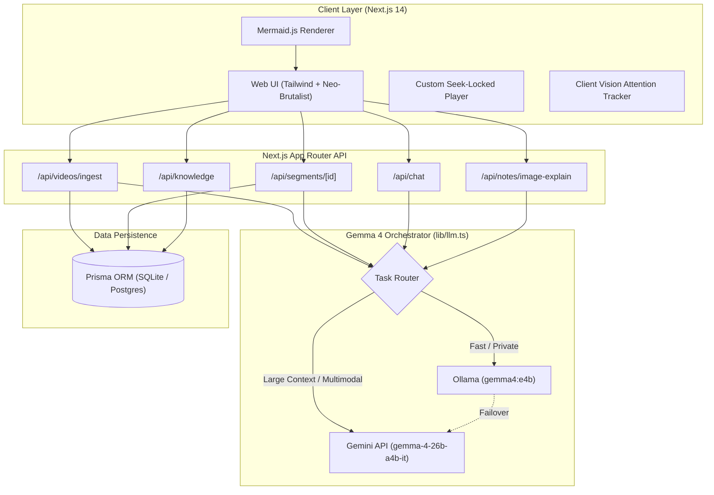

<div align="center">

# Saras AI ✦

### **Transform Passive Video Watching into Active, Mastery-Enforced Learning**

An intelligent, multimodal learning workspace powered by **Google Gemma 4** (Local & Cloud). Paste any YouTube educational video to unlock automated chapter segmentation, checkpoint quiz gating, visual Mermaid flowcharts & mind maps, lecture slide vision analysis, interactive concept knowledge graphs, and privacy-first focus tracking.

<br />

[](https://onto-aside-catching.ngrok-free.dev)

<br />

[](https://nextjs.org/)
[](https://tailwindcss.com/)
[](https://www.prisma.io/)
[](https://ai.google.dev/gemma)
[](https://mermaid.js.org/)
[](https://www.typescriptlang.org/)
[](https://opensource.org/licenses/MIT)

</div>

---

> 🚀 **Explore the Live App**: **[https://onto-aside-catching.ngrok-free.dev](https://onto-aside-catching.ngrok-free.dev)**  
> Experience real-time video chaptering, interactive quizzes, knowledge graphs, and visual mind maps instantly in your browser!

---

## ⚡ The Problem & The Saras AI Solution

Traditional video learning is notoriously passive. Students watch hours of technical lectures, retain under 20% within 48 hours, and skip ahead without verifying foundational concepts.

**Saras AI breaks this cycle with an active cognitive feedback loop:**
1. **Segment**: Videos are intelligently divided into bite-sized, digestible chapters using **Gemma 4**.
2. **Synthesize**: Each chapter automatically generates smart summaries, Mermaid flowcharts, mind maps, and flashcards.
3. **Verify**: Progress is seek-locked until the student answers a 4-question checkpoint quiz for that chapter.
4. **Connect**: Concepts are indexed into a dynamic 2D Knowledge Graph, tracking mastery across all lessons.

---

## 🌟 Key Features

### 🎬 1. Smart YouTube Ingestion & Deduplication
- Paste any YouTube educational video URL.
- Extracts metadata and full transcripts via YouTube's official endpoints.
- **Global Deduplication Cache**: If a video was previously processed, it loads instantaneously from database cache without re-running LLM inference.

### ⚡ 2. Gemma 4 Dual-Provider AI Engine (`lib/llm.ts`)
All generative tasks route through a unified abstraction layer supporting seamless local-cloud interoperability:
- **Local Provider (Ollama)**: Runs `gemma4:e4b` at zero cost with offline privacy, strict JSON output (`"think": false`), and low latency.
- **Cloud Provider (Gemini API)**: Runs `gemma-4-26b-a4b-it` for large-context transcript splitting and deep conceptual reasoning.
- **Resilience**: Automatic 2x retry on schema failures with automatic failover between local and cloud tiers.

| AI Capability | Model Tier | Provider | Output Contract |
| :--- | :---: | :---: | :--- |
| **Transcript Segmentation** | `gemma-4-26b-a4b-it` | Cloud | Structured JSON (3–8 logical chapters) |
| **Chapter Quizzes (4 Qs)** | `gemma4:e4b` / Cloud | Local First | Strict JSON (MCQ, options, explanations) |
| **Mind Maps & Flowcharts** | `gemma4:e4b` / Cloud | Local First | Node/Edge JSON $\to$ Mermaid Syntax |
| **Smart Notes Synthesis** | `gemma4:e4b` / Cloud | Local First | Markdown + Plain Text Formats |
| **Slide & Note Vision Breakdown** | Multimodal Cloud | Cloud | Deconstructed diagram components & takeaways |
| **Knowledge Graph Concepts** | `gemma-4-26b-a4b-it` | Cloud | Entities, categories & prerequisite links |
| **Saras AI Chat Co-Pilot** | `gemma-4-26b-a4b-it` | Cloud | Contextual Socratic tutoring |

### 🔒 3. Checkpoint Quiz Gating
- Custom YouTube player enforces chapter boundaries.
- When reaching the end of a segment, playback pauses and presents a checkpoint quiz.
- Advancing to the next chapter requires demonstrating comprehension, preventing mindless skipping.

### 📊 4. Visual Process Flowcharts & Mind Maps
- Gemma 4 outputs strict JSON syntax mapped into Mermaid.js graphs.
- Immune to syntax clashes with sanitized node IDs (`n_id`) and sanitized quotes.
- Features one-click **Export as SVG** and **Export as PNG** for study guides.

### 🖼️ 5. Multimodal Slide & Handwritten Note Analysis
- Upload slides, handwritten blackboard notes, or diagrams directly inside any chapter.
- Multimodal Gemma 4 deconstructs formulas, arrows, architecture diagrams, and variables into clear study notes.

### 🗺️ 6. 2D Interactive Concept Knowledge Graph
- Visual canvas connecting prerequisites, dependencies, and taxonomy.
- Dynamic mastery calculation (0–100%) based on quiz performance and flashcard recall.

### 🗂️ 7. Transcript-Grounded Spaced Repetition (Flashcards)
- Flashcards generated directly from spoken timestamps.
- Implements the SM-2 spaced repetition algorithm for optimal revision intervals.

### 🎯 8. Privacy-First Deep Focus Workspace
- Client-side WebAssembly face mesh attention tracking.
- Pauses playback and logs cognitive drift if you look away or lose focus—**zero video streams leave your device**.

### 📅 9. Adaptive Exam Preparation Planner
- Enter your target exam date and daily available study minutes.
- Generates a customized, paced daily study calendar balancing new chapters and active revision.

---

## 🎨 Design Philosophy: Editorial Neo-Brutalism

Saras AI is designed with an **Editorial Neo-Brutalist** aesthetic that feels tactile, functional, and premium:
- **Canvas Base**: `#F5F3EC` (Warm paper)
- **Surfaces**: `#FFFDF7` (Card white with sharp 2px solid borders)
- **Ink**: `#111218` (High-contrast typography & crisp shadows)
- **Accent**: `#B8FF3D` (Electric neon lime for mastery & actions)
- **Provenance Badges**: Every AI output shows a clear "Powered by Gemma 4 (local / cloud)" indicator.

---

## 🏗️ Architecture Overview



---

## 🛠️ Tech Stack

| Category | Technology |
| :--- | :--- |
| **Framework** | [Next.js 14](https://nextjs.org/) (App Router, Server Components, API Routes) |
| **Language** | [TypeScript 5](https://www.typescriptlang.org/) (Strict mode, Zod validation) |
| **Styling** | [Tailwind CSS 3.4](https://tailwindcss.com/) + Neo-Brutalism Custom Tokens |
| **Database & ORM** | [Prisma ORM 5.19](https://www.prisma.io/) with SQLite (local) / PostgreSQL |
| **AI Models** | **Google Gemma 4** (`gemma4:e4b` local via Ollama & `gemma-4-26b-a4b-it` cloud) |
| **Diagrams** | [Mermaid.js](https://mermaid.js.org/) (Client-side SVG rendering) |
| **Motion** | [Framer Motion](https://www.framer.com/motion/) |
| **Icons** | [Lucide React](https://lucide.dev/) |

---

## 🚀 Quick Start & Installation

### 1. Prerequisites
- **Node.js**: `v18.18+` or `v20+`
- **npm** or **pnpm**
- *(Optional for offline mode)*: [Ollama](https://ollama.ai/) installed with Gemma 4:
  ```bash
  ollama run gemma4:e4b
  ```

### 2. Clone the Repository
```bash
git clone https://github.com/badgujarkunal93-blip/sarasai.git
cd sarasai
npm install
```

### 3. Configure Environment Variables
Create a `.env` file in the root directory:
```env
# Database
DATABASE_URL="file:./dev.db"

# Local Ollama Provider (Runs Gemma 4 locally)
OLLAMA_URL="http://localhost:11434"
LLM_MODEL="gemma4:e4b"

# Cloud Gemini Provider (Gemma 4 via Gemini API)
GEMINI_API_KEY="your_gemini_api_key_here"
GEMMA_API_MODEL_NAME="gemma-4-26b-a4b-it"
```

### 4. Initialize Database
Push the Prisma schema to generate the SQLite database:
```bash
npx prisma db push
```

*(Optional)* Seed sample curated lessons:
```bash
npm run seed
```

### 5. Launch Development Server
```bash
npm run dev
```

Open [http://localhost:3000](http://localhost:3000) in your browser.

---

## 🌐 Public Tunneling (ngrok)

To expose your local instance with full AI capabilities:
```bash
ngrok http 3000
```
Then access your deployment link (e.g. `https://onto-aside-catching.ngrok-free.dev`).

---

## 🧪 Verification & Health Checks

Verify type-safety and build readiness with zero errors:

```bash
# Type-checking
npm run typecheck

# Production build validation
npm run build
```

---

## 📂 Project Directory Structure

```text
saras-ai/
├── app/                      # Next.js 14 App Router
│   ├── api/                  # Backend REST API routes
│   │   ├── chat/             # Saras AI Socratic tutor co-pilot
│   │   ├── exams/            # Adaptive study calendar planner
│   │   ├── flashcards/       # Spaced repetition endpoints
│   │   ├── knowledge/        # Concept graph & mastery data
│   │   ├── notes/            # Smart notes & vision upload analysis
│   │   ├── progress/         # Checkpoint & chapter progress tracking
│   │   └── videos/           # YouTube ingestion & caching
│   ├── discover/             # Video search, input & discovery feed
│   ├── exam/                 # Exam preparation calendar view
│   ├── flashcards/           # Interactive flashcard review deck
│   ├── focus/                # Deep focus attention tracker
│   ├── knowledge/            # 2D Knowledge Graph visualization
│   ├── revision/             # Daily active recall revision portal
│   └── video/[id]/           # Lesson player, quizzes, notes & diagrams
├── components/               # Modular UI components
│   ├── chat/                 # Floating AI tutor drawer
│   ├── diagrams/             # Mermaid flowchart & mindmap components
│   ├── notes/                # Smart notes editor & vision upload
│   ├── player/               # Custom seek-locked YouTube video player
│   └── quiz/                 # Checkpoint gating quizzes
├── lib/                      # Core business logic & services
│   ├── db.ts                 # Prisma client instance
│   ├── diagrams.ts           # Mermaid sanitizer & JSON-to-diagram converter
│   ├── llm.ts                # Gemma 4 dual-provider orchestrator
│   └── services/             # Ingestion, transcript, and AI pipelines
├── prisma/                   # Database schema & migrations
│   ├── schema.prisma         # Multi-model relational schema
│   └── seed.ts               # Sample educational lessons
└── public/                   # Static assets & icons
```

---

## 🤝 Contributing

Contributions are welcome! Please feel free to submit a Pull Request.

1. Fork the Project
2. Create your Feature Branch (`git checkout -b feature/AmazingFeature`)
3. Commit your Changes (`git commit -m 'Add some AmazingFeature'`)
4. Push to the Branch (`git push origin feature/AmazingFeature`)
5. Open a Pull Request

---

## 📄 License

Distributed under the **MIT License**. See `LICENSE` for more information.

<div align="center">
  <sub>Crafted with passion for active, deep learning. Powered by <b>Google Gemma 4</b>.</sub>
</div>
